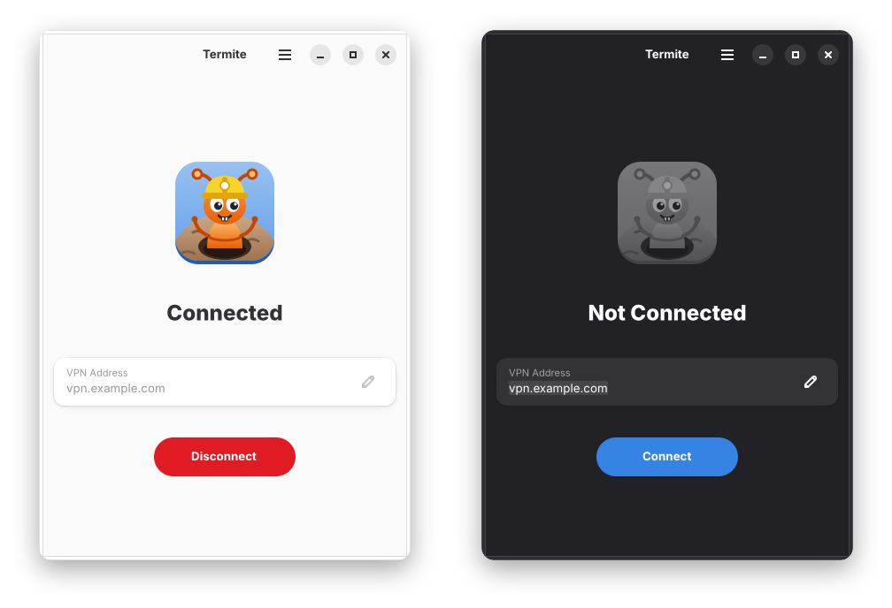
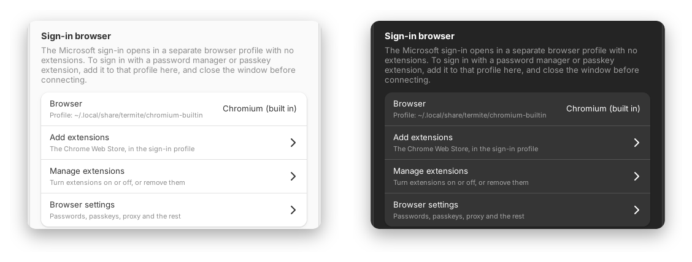

<p align="center">
  
</p>

<h1 align="center">Termite</h1>

<p align="center">
  <b>Cisco Secure Client VPN with Microsoft sign-in, for any Linux desktop.</b><br>
  <sub>Termites dig tunnels.</sub>
</p>

<p align="center">
  <a href="https://github.com/tahuffman1s/termite/releases/latest"></a>
  <a href="LICENSE"></a>
</p>

<p align="center">
  
</p>

Cisco's "embedded browser" sign-in only works in the window it happened in, so
the usual Linux VPN dialogs can't use a passkey, a phone, or a password-manager
extension. Termite signs you in through a real Chromium window instead, then
brings up the tunnel.

## Features

- 🔑 **Real browser sign-in**: passkeys, "use a phone" QR codes, and
  password-manager extensions, in a Chromium profile of its own
- 📦 **Everything included**: Chromium and OpenConnect come in the AppImage;
  no plugins needed
- 🌐 **Plays well with your desktop**: uses NetworkManager when it can, so the
  VPN shows in your network menu
- 🐜 **Tray icon**: see at a glance whether you're connected; connect and
  disconnect from the menu
- 🩺 **DNS that answers**: the VPN's DNS servers get only the company's
  names, and the rest of the internet keeps going to your usual DNS, so a
  VPN server that stops answering can't hold up every lookup for five
  seconds; and each of them is asked for a company name and an outside
  one, the one that answers both, fastest, going first
- 🎨 **A proper GNOME app**: current GTK 4 and libadwaita, light and dark,
  adaptive down to phone size
- 🐧 **Any distribution**: Ubuntu, Debian, Fedora, Arch, openSUSE, NixOS…
  (glibc 2.35 or newer)
- 🔒 **Nothing secret stored**: the VPN session ends with the connection

## Get it

Download the AppImage from the
[latest release](https://github.com/tahuffman1s/termite/releases/latest), then:

```sh
chmod +x Termite-*-x86_64.AppImage
./Termite-*-x86_64.AppImage
```

Enter your VPN address (the one Cisco Secure Client uses), press **Connect**,
and sign in with Microsoft in the window that opens. That's it.

## Extensions

The sign-in browser starts clean. To sign in with a password manager or
passkey extension (Proton Pass, Bitwarden, 1Password…), open
**Preferences → Browser → Add Extensions** and install it from the Chrome Web
Store. You can also pick an installed Chrome, Brave, Edge or Vivaldi there
instead of the built-in Chromium.

<p align="center">
  
</p>

<details>
<summary><b>Command line</b></summary>

```
termite                          the window
termite connect --gateway vpn.example.com [--group G]
termite disconnect | status
termite browser [store|extensions|settings]
termite sign-in GATEWAY [GROUP]  only sign in; print the session as JSON
termite info                     what was found on this system
```

Settings live in `~/.config/termite/config.json`.
</details>

<details>
<summary><b>DNS</b></summary>

With a split tunnel (the usual kind: only the company's networks go through
the VPN), Termite keeps the VPN's DNS servers to the company's names: the
domains the gateway names, any you add under **Preferences → DNS → Company
Domains** (or `--domains`), and the reverse zones of the VPN's networks.
Every other name goes to your usual DNS, as before connecting, so a VPN
server that stops answering can't hold up every website for five seconds.
The Connection Log shows the domains.

This needs a resolver on your computer that routes names by domain:
systemd-resolved (Ubuntu, Fedora and Arch have it on by default), or
NetworkManager's own (`dns=systemd-resolved` or `dns=dnsmasq` in
`NetworkManager.conf`). Where programs read `/etc/resolv.conf` directly
instead (it lists the VPN's servers, not `127.0.0.53`), they ask its
servers in turn, the VPN's first, and nothing can do better than put the
one that answers first, which Termite does; the log says so. To switch to
systemd-resolved:

```sh
sudo systemctl enable --now systemd-resolved
sudo ln -sf /run/systemd/resolve/stub-resolv.conf /etc/resolv.conf
sudo systemctl restart NetworkManager   # if that is how you connect to the network
```

A VPN that takes all traffic keeps its DNS servers for every name. The
switch under **Preferences → DNS** turns this off.
</details>

<details>
<summary><b>How it works</b></summary>

- Termite does the AnyConnect handshake itself, opens the Microsoft sign-in in
  Chromium, and reads the result over Chromium's DevTools pipe.
- With NetworkManager's OpenConnect plugin, it hands the session to
  NetworkManager: no password prompt, and the VPN shows in the network menu.
- Without the plugin, it runs OpenConnect (the bundled 9.21; yours, if 9.0+,
  only when there is no bundle) as root, after asking for your password
  through `pkexec`, or `systemd-run` inside sandboxes like NixOS's
  `appimage-run`. vpnc-script sets up routes and DNS.
- The tunnel has to prove it holds the key the sign-in was tied to (STRAP),
  which openconnect only does when built with HPKE support. The bundled one
  is. If your distribution's isn't, the gateway answers the tunnel with
  `401 Unauthorized` and openconnect says "Cookie was rejected by server";
  NetworkManager's plugin always runs the distribution's, so it can't connect
  then. `strings "$(ldd "$(command -v openconnect)" | grep -o '/[^ ]*libopenconnect[^ ]*')" | grep -c STRAP-Verify`
  prints 0 for such a build.
- The built-in Chromium is Google's open-source build from the current Stable
  branch point, refreshed with each Termite release.
- Closing the window keeps Termite in the tray. Quit from the tray, or with
  Ctrl+Q.
- **Connection Log** in the menu shows what happened; About → Troubleshooting
  has the details worth sending with a bug report.
- `TERMITE_BROWSER_LOG=1` shows the browser's own messages if it won't start.
</details>

<details>
<summary><b>Building</b></summary>

```sh
packaging/build-appimage.sh     # → dist/Termite-<version>-x86_64.AppImage
python3 -m unittest discover -s tests
```

The build runs in an `ubuntu:22.04` container (Docker or Podman), so the
AppImage needs only glibc 2.35. On that base it builds current GTK 4 (4.22) and
libadwaita (1.9) with what they need (`packaging/build-gnome.sh`, about half an
hour the first time; `TERMITE_GNOME_PREFIX=<dir>` keeps it), OpenConnect from
source, and adds Chromium. Behind a TLS-inspecting proxy, set
`BUILD_CA_CERT=<ca file>`. GitHub Actions builds every push (keeping the GNOME
build in its cache). Run the workflow with **release** ticked to publish.
</details>

## License

Termite is [MIT](LICENSE). The AppImage also carries Chromium (BSD),
OpenConnect (LGPL-2.1, source included), vpnc-script (GPL-2.0), GTK, libadwaita
and the libraries they need (LGPL and similar, built from their release
tarballs), and libraries from Ubuntu. Their licenses and sources are listed in the AppImage under
`usr/share/licenses/`.
